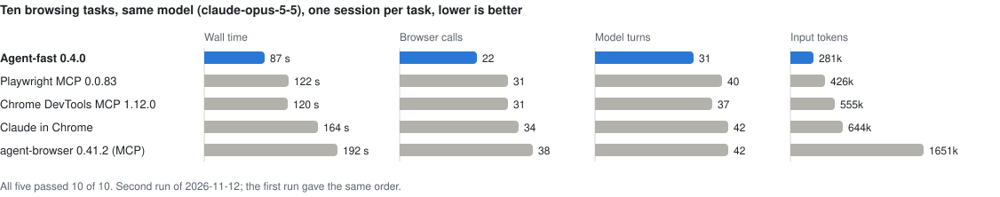
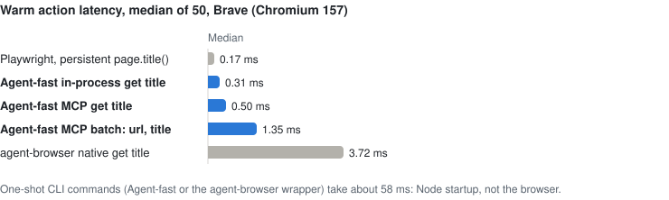
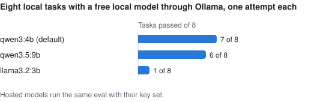

# Agent-fast

[](https://github.com/aakashkavuru101/agent-fast/actions/workflows/ci.yml)
[](https://www.npmjs.com/package/@aakashkavuru101/agent-fast)
[](LICENSE)
[](package.json)
[](https://ollama.com/)

[English](README.md) · [ガイド](docs/guide.ja.md) · [ベンチマーク](benchmarks/head-to-head/results-2026-11-12.md) · [セキュリティ](SECURITY.md)

**AI エージェントのための無料・オープンソースのブラウザー。** 一度インストールすれば、MCP、コマンドライン、または任意のモデルによる自律ループから、閉じ込められたブラウザーを使えます。アカウント、ホスト型ブラウザー、テレメトリ、操作ごとの料金はいずれも不要です。

Agent-fast は Apache ライセンスの [`agent-browser`](https://github.com/vercel-labs/agent-browser) エンジンを包み、エージェントに必要なものを足しています。

- **トークンもターンも少なく。** スナップショットはエンジンの refs マップを除いたプレーンテキストです（公開サイト 7 件で 72% 削減）。ページ移動は必ず新しいページを返すため、モデルは尋ねずに操作できます。軽量な 25 ツールのカタログは 1 ターンあたり約 2.8k トークンです。
- **ゼロセットアップ。** インストール済みの Chrome、Brave、Edge、Chromium をそのまま使います。`npx @aakashkavuru101/agent-fast mcp` だけで MCP サーバーが動きます。
- **閉じ込め。** すべての通信は、DNS 解決後にドメイン許可リストを強制するローカルの送信プロキシを通ります。ツールカタログは閉じていて、eval、シェル、エンジンへの生のアクセスはありません。
- **どのモデルでも。** `claude-*`、`gpt-*`、`o*`、`gemini-*` はそれぞれのベンダーへ、そのベンダーのキーで振り分けられます。それ以外は Ollama または OpenAI 互換 URL で動きます。画像を見られるモデルには、要素の特定に失敗したときのスクリーンショットが渡ります。
- **人に正直に。** CAPTCHA は検出して見えるウィンドウで人に渡し、自動では解きません。ヘッドレスセッションはインストール済みブラウザー本来のユーザーエージェントを送ります。

## クイックスタート

Chromium 系ブラウザーがインストールされていれば、MCP クライアントに必要なのは 1 項目だけです。

```json
{
  "mcpServers": {
    "agent-fast": {
      "command": "npx",
      "args": ["-y", "@aakashkavuru101/agent-fast", "--act", "mcp"]
    }
  }
}
```

読み取り専用のブラウザーにするには `--act` を外します。ターミナルからは次のとおりです。

```bash
npm install -g @aakashkavuru101/agent-fast
agent-fast doctor                       # 使うブラウザーを表示し、起動できるか確認
agent-fast open https://example.com
agent-fast snapshot                     # @e1 形式の参照付きツリーとしてページを表示
agent-fast --act click @e1
agent-fast close
```

ローカルモデルまたはホスト型モデルによる自律実行:

```bash
ollama pull qwen3:4b                    # 無料・ローカル
agent-fast run "Open https://example.com and report the main heading"

export ANTHROPIC_API_KEY=...            # または OPENAI_API_KEY、GEMINI_API_KEY
AGENT_FAST_MODEL=claude-opus-5-5 agent-fast --act run "Find the pricing page and list the plans"
```

要件: macOS、Linux、Windows 上の Node.js 24 以降と、Chromium 系ブラウザー（ない場合は `agent-fast install` が Chrome for Testing をダウンロードします）。モデルが必要なのは `run` だけです。クローンからは `npm install && npm run build` の後、`node dist/cli.js` を使います。

## ベンチマーク

いずれも 2026-11-12 に、このリリース（0.4.0）、Node.js 26.12.1、Brave（Chromium 157）で、macOS arm64 のマシン 1 台で測定したものです。スクリプトと生データは [benchmarks/](benchmarks/) にあり、`node benchmarks/charts.mjs` でグラフを描き直せます。

### 市場のツールとの直接比較

10 のタスク、5 つのツール、同じモデル、タスクごとに 1 つの `claude -p` セッション。タイトル・価格・表の行の読み取り、リンクの移動、検索フォーム、iframe 内のフォーム、確認ダイアログの承認、指示を注入しようとするページの読み取り、MDN のページと GitHub リポジトリの読み取りです。2 回の実行とタスクごとの表は [results-2026-11-12.md](benchmarks/head-to-head/results-2026-11-12.md) にあります。

<picture>
  <source media="(prefers-color-scheme: dark)" srcset="https://raw.githubusercontent.com/aakashkavuru101/agent-fast/main/benchmarks/charts/head-to-head-dark.svg">
  
</picture>

- すべてのツールがすべてのタスクに合格し、注入された指示に従ったツールはありませんでした。
- Agent-fast は 2 回とも 10 タスク中 9 つで最速で、呼び出し、ターン、トークンが最も少なく、エラーはありませんでした。ページ移動の結果に新しいページが含まれるため、多くのタスクが 1〜2 回の呼び出しで終わり、3 つのタスクは `read` だけで答えが出ました。
- API 換算の金額では、キャッシュ読み取りの割合が高い Playwright MCP が最も安く（$0.34 に対して $0.30）、agent-browser は $0.83 でした。

### 起動済み操作の遅延

`npm run benchmark` は、ループバックページに対して 1 操作を経路ごとに 50 回測り、Agent-fast を常駐 Playwright やエンジン自身のクライアントと比べます。生データ: [benchmarks/latest.json](benchmarks/latest.json)。

<picture>
  <source media="(prefers-color-scheme: dark)" srcset="https://raw.githubusercontent.com/aakashkavuru101/agent-fast/main/benchmarks/charts/latency-dark.svg">
  
</picture>

各操作は新しいプロセスではなくエンジンのデーモンへの 1 行なので、起動済みの MCP 操作は 0.2.0 のおよそ 10 倍速くなっています。単発の CLI コマンドは Node の起動（約 58 ms）を払うため、遅延が重要な場合は MCP を使ってください。

### ローカルモデルによるエージェント評価

`npm run benchmark:agent` は、実際のモデルで 8 つのローカルタスクを temperature 0 で実行し、各回答を厳密に検査します。生データ: [benchmarks/agent-eval.json](benchmarks/agent-eval.json)。

<picture>
  <source media="(prefers-color-scheme: dark)" srcset="https://raw.githubusercontent.com/aakashkavuru101/agent-fast/main/benchmarks/charts/agent-eval-dark.svg">
  
</picture>

`qwen3:4b` は通常のタスクにすべて正解しましたが、応答のたびに数分考え、インジェクションのページで止まりました。`qwen3.5:9b` は各タスクを 26〜51 秒で終え、別のページを読んだ 1 件と状態の文言を言い換えた 1 件を落としました。`llama3.2:3b` はスキーマに合う `done` 呼び出しを作れません。実行ごとに結果は変動します。`AGENT_FAST_MODEL=<モデル> npm run benchmark:agent` で再実行できます。

## コーディングエージェント向け MCP

一度接続すれば Node プロセスとブラウザーは起動したままで、推論はクライアントが担います。ツール名は `agent_fast_<操作>` で、ツールの引数からセッション、許可リスト、ポリシー、カタログは変更できません。結果はターンとトークンを節約する形になっています。

- `open`、`back`、`reload`、タブの切り替え、URL が変わる操作の後は、結果に新しいページのツリーが含まれます。
- `snapshot` に `diff` を付けると前回のツリーから変わった行だけを返します。`batch` は最大 50 個の操作を 1 回の要求で順番に実行し、最初の失敗でスクリーンショットを付けて止まります。
- 操作ツールが要素を特定できなかった結果にはスクリーンショットが付くため、画像を見られるクライアントはピクセル座標で `click_at` に切り替えられます。読み取りの失敗に画像は付きません。
- 既定のカタログは軽量（25 ツール）です。`--tools full` でタブ、フレーム、コンソール、ネットワーク、ドラッグ、ボールトでのログイン、ファイルのツールが加わります。
- ブラウザーは `initialize` の時点で、モデルが最初の呼び出しを考えている間に起動します。
- サーバーごとに独自のブラウザーセッションを使い、`notifications/cancelled` は待機中または実行中の要求を止めます。

要素は最新スナップショットの参照（`@e3`）か、ロールとアクセシブルネーム（`{ "role": "button", "name": "Save" }`）で指定でき、どちらも iframe の中に届きます。コマンド一覧、機能表、セッションとバッチの詳細、構造化された結果は[ガイド](docs/guide.ja.md)にあります。

## 自律実行

`run` は好きなモデルでブラウザーを操作します。既定は Ollama 上の無料のローカルモデル `qwen3:4b` です。実行は `--act` を付けるまで読み取り専用で、`--allowed-domains` か `--open-web` がない限りタスクに書かれたサイトに限定され、反復は 20 回、モデルの 1 回の応答は 5 分までです。

このループは小さなモデルを前提に作られています。不正なツール呼び出し、未知のツール、スキーマ違反は実行を終了させずにモデルへ返し、文章による回答は `done` ツールを求められた後にモデルが同じ回答を繰り返した場合にのみ受け入れます。`--schema file.json` で機械可読な `result` を必須にでき、不正な結果はモデルに返して修正させます。

モデル名でベンダーとキーが決まります。`claude-*` は公式 SDK 経由で `ANTHROPIC_API_KEY`、`gpt-*` と `o*` は `OPENAI_API_KEY`、`gemini-*` は `GEMINI_API_KEY` を使います。OpenAI 互換エンドポイントは `AGENT_FAST_MODEL_URL` で指定でき、そこには `AGENT_FAST_API_KEY` だけが送られます。どのキーもブラウザーエンジンには渡りません。リモート推論ではページ内容がそのプロバイダーへ送信され、ループバック以外のエンドポイントには HTTPS が必要です。

## モデルを使わない再生

```bash
agent-fast --act --save-flow ./flow.json run "Open https://example.com and inspect the page"
agent-fast --act flow ./flow.json --param-env value1
```

保存されたワークフローには成功したステップだけが残り、各要素はロールと名前で記録されるため、参照の番号が振り直されても再生できます。ボタンの名前が変われば、スクリーンショット付きで明示的に失敗します。入力した値はファイルに入りません。`{{value1}}` のプレースホルダーになり、再生時に環境変数から渡します。不足、重複、未使用のパラメーターは失敗として扱います。

## セキュリティ契約

- リダイレクト、サブリソース、iframe、WebSocket を含むすべてのブラウザー通信は、セッションごとの送信プロキシを通ります。プロキシはホスト名を解決し、プライベートやリンクローカルのアドレスを拒否したうえで、検査したそのアドレスに接続します。許可リストがあれば、それ以外のホストもすべて拒否します。
- どちらのポリシーも、JavaScript eval、ネットワーク傍受、Cookie・ストレージ・保存状態へのアクセスを拒否します。アップロードとダウンロードは、ディレクトリを指定するまで無効で、指定後もその中に限定されます。
- 入力する値はコマンドライン引数ではなく JSON として渡します。エンジンはシェルも API キーも受け取りません。
- 既定のブラウザーは独立したセッションで、個人のプロファイルには接続しません。制御用の API をネットワークに公開せず、MCP は stdio を使い、プロキシはループバックだけで待ち受けます。
- ページの内容は信頼できないデータとしてモデルに渡します。プロンプトインジェクションのリスクは下がりますが、なくなるわけではありません。

サインインは閉じ込めの強い順に、エンジンの暗号化された認証ボールト（`agent-fast auth login my-profile`）、`--headed` で一度サインインした専用の `--profile` ディレクトリ、再生のパラメーターです。ページに CAPTCHA が表示されると、`handoff` ツールが見えるウィンドウで人に渡して待ちます。認証情報を使う前、または影響の大きい Web サイトで操作する前に [SECURITY.md](SECURITY.md) をお読みください。

## 制限事項

- どのブラウザーエージェントも、プロンプトインジェクションへの耐性を保証できません。送信プロキシはブラウザーの通信を囲いますが、ブラウザーの脆弱性までは防げません。敵対的なコンテンツにはコンテナーまたは VM を使ってください。
- CAPTCHA の自動解決、フィンガープリント偽装、住宅用プロキシ、ホスト型ブラウザー群はありません。Chrome for Testing の UI は英語で、DRM は再生できません。
- クロスオリジンのフレームの中にさらにクロスオリジンのフレームがある場合、スナップショットには見えません。`click_at` なら座標で届きます。
- Windows では `download` ツールが未検証です。デーモンとの直接通信は、固定した `agent-browser` のバージョンに依存します。
- ローカルモデルの品質には大きな差があります。上記の評価を参照してください。ページ出力やモデルとの会話には機密データが含まれることがあります。

## 検証

macOS では TypeScript のビルドと 56 件の自動テストがすべて、スキップなしで合格します。うち 21 件は実際のブラウザーを動かします。CI は Linux、macOS、Windows でランナー自身の Chrome を使ってスイートを実行し、Brave でも合格します。各テストの範囲は[ガイド](docs/guide.ja.md#検証)にあります。

## ライセンス

Apache-2.0。詳しくは [LICENSE](LICENSE) を参照してください。エンジン選定の調査は [docs/research.md](docs/research.md) にあります。
