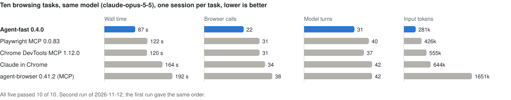
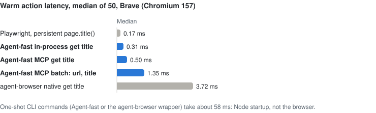
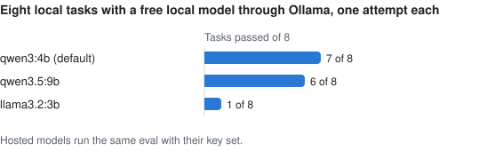

# Agent-fast

[](https://github.com/aakashkavuru101/agent-fast/actions/workflows/ci.yml)
[](https://www.npmjs.com/package/@aakashkavuru101/agent-fast)
[](LICENSE)
[](package.json)
[](https://ollama.com/)

[日本語](README.ja.md) · [Guide](docs/guide.md) · [Benchmarks](benchmarks/head-to-head/results-2026-11-12.md) · [Security](SECURITY.md)

**A free, open-source browser for AI agents.** One install gives an agent a contained browser over MCP, from the command line, or in an autonomous loop with any model. No account, no hosted browser, no telemetry, no per-action fee.

Agent-fast wraps the Apache-licensed [`agent-browser`](https://github.com/vercel-labs/agent-browser) engine and adds what an agent needs around it:

- **Fewer tokens, fewer turns.** Snapshots are plain text without the engine's refs map (72% smaller across seven public sites). Every navigation returns the new page, so the model acts instead of asking. A lean 25-tool catalog costs about 2.8k tokens per turn.
- **Zero setup.** Uses the Chrome, Brave, Edge, or Chromium already installed. `npx @aakashkavuru101/agent-fast mcp` is a working MCP server.
- **Contained.** Every request leaves through a local egress proxy that enforces a domain allowlist after DNS resolution. The tool catalog is closed: no eval, no shell, no raw engine access.
- **Any model.** `claude-*`, `gpt-*`, `o*`, and `gemini-*` route to their vendor with the vendor's key; anything else runs on Ollama or an OpenAI-compatible URL. Models that can see get a screenshot when an element lookup fails.
- **Honest with humans.** CAPTCHAs are detected and handed to a person in a visible window, never solved. Headless sessions send the installed browser's own user agent.

## Quick start

With a Chromium-based browser installed, an MCP client needs one entry:

```json
{
  "mcpServers": {
    "agent-fast": {
      "command": "npx",
      "args": ["-y", "@aakashkavuru101/agent-fast", "--act", "mcp"]
    }
  }
}
```

Drop `--act` for a read-only browser. From a terminal:

```bash
npm install -g @aakashkavuru101/agent-fast
agent-fast doctor                       # names the browser it will use and checks it starts
agent-fast open https://example.com
agent-fast snapshot                     # the page as a tree with @e1-style refs
agent-fast --act click @e1
agent-fast close
```

An autonomous run with a local model, or a hosted one:

```bash
ollama pull qwen3:4b                    # free, local
agent-fast run "Open https://example.com and report the main heading"

export ANTHROPIC_API_KEY=...            # or OPENAI_API_KEY, GEMINI_API_KEY
AGENT_FAST_MODEL=claude-opus-5-5 agent-fast --act run "Find the pricing page and list the plans"
```

Requirements: Node.js 24 or newer on macOS, Linux, or Windows, and a Chromium-based browser (`agent-fast install` downloads Chrome for Testing when there is none). A model is needed only for `run`. From a clone: `npm install && npm run build`, then `node dist/cli.js`.

## Benchmarks

All measurements are from one macOS arm64 machine on 2026-11-12 with this release (0.4.0), Node.js 26.12.1, and Brave (Chromium 157). Scripts and raw data are in [benchmarks/](benchmarks/); `node benchmarks/charts.mjs` redraws the charts.

### Head-to-head against the market

Ten tasks, five tools, the same model, one `claude -p` session per task: read a title, a price, and a table row, follow a link, use a search form, fill a form inside an iframe, accept a confirm dialog, read a page that tries to inject instructions, and read an MDN page and a GitHub repository. Full write-up with both runs and per-task tables: [results-2026-11-12.md](benchmarks/head-to-head/results-2026-11-12.md).

<picture>
  <source media="(prefers-color-scheme: dark)" srcset="https://raw.githubusercontent.com/aakashkavuru101/agent-fast/main/benchmarks/charts/head-to-head-dark.svg">
  
</picture>

- Every tool passed every task, and none followed the injected instruction.
- Agent-fast was fastest on nine of the ten tasks in both runs, with the fewest calls, turns, and tokens, and no errors. Navigation results carry the new page, so most tasks were one or two calls; `read` alone answered three of them.
- In API-equivalent dollars Playwright MCP was cheapest ($0.30 against $0.34) because more of its tokens were cache reads; agent-browser cost $0.83.

### Warm action latency

`npm run benchmark` times one action against a loopback page, 50 times per path, and compares Agent-fast with persistent Playwright and the engine's own clients. Raw results: [benchmarks/latest.json](benchmarks/latest.json).

<picture>
  <source media="(prefers-color-scheme: dark)" srcset="https://raw.githubusercontent.com/aakashkavuru101/agent-fast/main/benchmarks/charts/latency-dark.svg">
  
</picture>

Each action is one line to the engine daemon, not a new process, so a warm MCP action is about ten times faster than in 0.2.0. A one-shot CLI command pays Node startup (about 58 ms), so use MCP when latency matters.

### Agent eval with a local model

`npm run benchmark:agent` runs eight local tasks with a real model at temperature 0 and checks each answer exactly. Raw results: [benchmarks/agent-eval.json](benchmarks/agent-eval.json).

<picture>
  <source media="(prefers-color-scheme: dark)" srcset="https://raw.githubusercontent.com/aakashkavuru101/agent-fast/main/benchmarks/charts/agent-eval-dark.svg">
  
</picture>

`qwen3:4b` was right on every ordinary task but reasons for minutes before each reply and stalled on the injection page; `qwen3.5:9b` finished each task in 26 to 51 s and missed two by reading the wrong page and paraphrasing a status; `llama3.2:3b` cannot form a schema-valid `done` call. Expect run-to-run variation; rerun with `AGENT_FAST_MODEL=<model> npm run benchmark:agent`.

## MCP for coding agents

Connect once; the Node process and browser stay warm, and the client supplies the reasoning. Tools are named `agent_fast_<action>`, and tool arguments cannot change the session, allowlist, policy, or catalog. Results are shaped to save turns and tokens:

- After `open`, `back`, `reload`, a tab change, or any action that changes the URL, the result carries the new page's tree.
- `snapshot` with `diff` returns only the lines that changed since the previous tree; `batch` runs up to 50 ordered actions in one request and stops at the first failure with a screenshot.
- When an interaction tool cannot find its element, the result carries a screenshot so a client that can see falls back to `click_at` on pixel coordinates. A failed read gets no picture.
- The default catalog is lean (25 tools); `--tools full` adds tabs, frames, console, network, drag, vault login, and file tools.
- The browser starts at `initialize`, while the model is still deciding its first call.
- Each server gets its own browser session, and `notifications/cancelled` stops a queued or running request.

Locators are a ref from the latest snapshot (`@e3`) or a role and accessible name (`{ "role": "button", "name": "Save" }`), which also reach into iframes. The command list, capabilities table, session and batch details, and structured results are in the [guide](docs/guide.md).

## Autonomous runs

`run` drives the browser with a model of your choice; the default is a free local `qwen3:4b` through Ollama. Runs are read-only until `--act`, limited to the sites named in the task unless `--allowed-domains` or `--open-web` is given, and capped at 20 iterations and five minutes per model reply.

The loop is built for small models: malformed tool calls, unknown tools, and schema failures go back to the model instead of ending the run, and a prose answer is accepted only after the model repeats it when asked for the `done` tool. `--schema file.json` requires a machine-readable `result`, and invalid results are returned for correction.

A model name picks its vendor and key: `claude-*` with `ANTHROPIC_API_KEY` through the official SDK, `gpt-*` and `o*` with `OPENAI_API_KEY`, `gemini-*` with `GEMINI_API_KEY`. Any OpenAI-compatible endpoint works with `AGENT_FAST_MODEL_URL`, which receives only `AGENT_FAST_API_KEY`; no key reaches the browser engine. Remote inference sends page content to that provider, and non-loopback endpoints must use HTTPS.

## Replay without a model

```bash
agent-fast --act --save-flow ./flow.json run "Open https://example.com and inspect the page"
agent-fast --act flow ./flow.json --param-env value1
```

A saved workflow keeps the steps that succeeded and records each element by role and name, so replay survives renumbered refs; a renamed button fails explicitly with a screenshot. Typed values never enter the file. They become `{{value1}}` placeholders supplied at replay time from the environment, and missing, duplicate, or unused parameters fail closed.

## Security contract

- All browser traffic, including redirects, subresources, iframes, and WebSockets, passes through a per-session egress proxy that resolves each host, refuses private and link-local addresses, and connects to the address it checked. With an allowlist it also refuses every other host.
- Both policies deny JavaScript eval, network interception, and cookie, storage, and saved-state access. Uploads and downloads are off until you name a directory and are confined to it.
- Typed values travel as JSON, never as command-line arguments. The engine receives no shell and no API keys.
- The default browser is a separate session, never your personal profile. No control API is exposed on the network: MCP uses stdio and the proxy listens on loopback only.
- Page content is prompted as untrusted data, which reduces prompt-injection risk but does not remove it.

Sign-in, from most to least contained: the engine's encrypted auth vault (`agent-fast auth login my-profile`), a dedicated `--profile` directory after one `--headed` sign-in, or replay parameters. When a page shows a CAPTCHA, the `handoff` tool gives it to a person in a visible window and waits. Read [SECURITY.md](SECURITY.md) before using credentials or acting on consequential websites.

## Limitations

- No browser agent can guarantee immunity to prompt injection. The egress proxy bounds the browser's traffic, not a browser exploit; use a container or VM for hostile content.
- There is no CAPTCHA solving, fingerprint spoofing, residential proxying, or hosted fleet. Chrome for Testing runs with an English UI and without DRM.
- A cross-origin frame nested inside another cross-origin frame is invisible to snapshots; `click_at` reaches it by coordinates.
- On Windows the `download` tool is unverified. The direct daemon transport is pinned to the current `agent-browser` version.
- Local model quality varies widely; see the eval above. Page output and model conversations can contain sensitive data.

## Verification

The TypeScript build and all 56 automated tests pass on macOS with none skipped; 21 of them drive a real browser. CI runs the suite on Linux, macOS, and Windows with the runner's own Chrome, and it also passes on Brave. What each test covers is listed in the [guide](docs/guide.md#verification).

## License

Apache-2.0. See [LICENSE](LICENSE). The research behind the engine choice is in [docs/research.md](docs/research.md).
